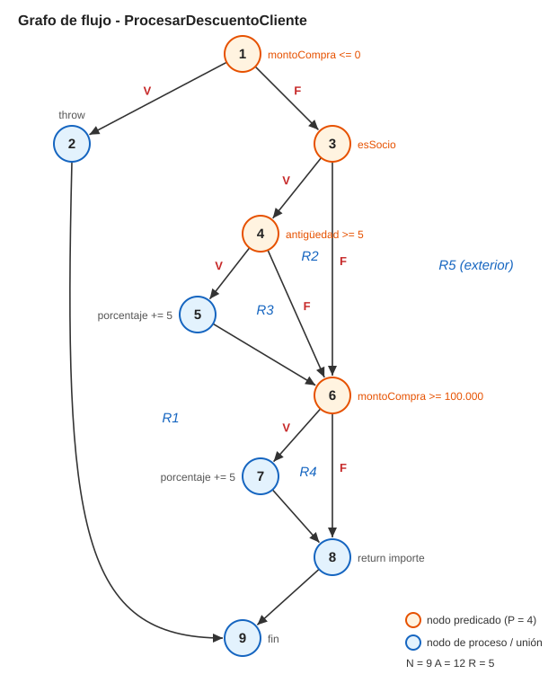

# TP 2 - Prueba de Software

Resolución del Trabajo Práctico Nro 2 de Prueba de Software. El enunciado pedía C# con xUnit "o equivalente", así que lo hicimos en Java 25 con JUnit 5 y Maven.

El TP tiene tres partes:

**1. Caja blanca (camino básico).** Escribimos la función `procesarDescuentoCliente`, que calcula un descuento según la antigüedad del cliente, el monto de la compra y si es socio, armada para que tenga complejidad ciclomática 5. Sobre esa función hicimos el grafo de flujo y calculamos V(G) de las tres formas (aristas y nodos, nodos predicado y regiones). Después sacamos los 5 caminos independientes y escribimos un caso de prueba para cada uno.

**2. Caja negra.** Para las seis funciones del enunciado (descuento por monto y VIP, validación de contraseña, precio de entrada a un parque, solicitud de crédito, multa de tránsito y uso de almacenamiento) definimos las clases de equivalencia y los valores límite, y con eso armamos una matriz de casos de prueba.

**3. Automatización.** Implementamos las seis funciones y automatizamos toda la matriz con JUnit 5. Los mismos casos corren contra dos implementaciones: la nuestra y los webservices que dio la cátedra (`http://iso-2026.somee.com/test`). Si un caso pasa en nuestra versión y falla en el servicio, el error está en el servicio.

## Grafo de flujo y complejidad ciclomática

<p align="center">
  
</p>

La función tiene 4 decisiones simples (los nodos naranjas 1, 3, 4 y 6). Las tres formas de calcular V(G) dan el mismo resultado:

| Método | Cálculo | V(G) |
| --- | --- | --- |
| Aristas y nodos | A − N + 2 = 12 − 9 + 2 | 5 |
| Nodos predicado | P + 1 = 4 + 1 | 5 |
| Regiones | R1 a R4, más la exterior R5 | 5 |

Los 5 caminos independientes, con el caso de prueba de cada uno:

| Camino | Recorrido | Caso de prueba |
| --- | --- | --- |
| C1 | 1-2-9 | monto 0: lanza excepción |
| C2 | 1-3-6-8-9 | no socio, $50.000: sin descuento |
| C3 | 1-3-4-6-8-9 | socio con 2 años, $50.000: 10 % |
| C4 | 1-3-4-5-6-8-9 | socio con 8 años, $50.000: 15 % |
| C5 | 1-3-6-7-8-9 | no socio, $200.000: 5 % |

## Resultados

- Nuestra implementación pasa los 188 tests, con 100 % de cobertura de ramas según JaCoCo.
- Contra el webservice corren 175 tests y fallan 10. Las fronteras de las seis funciones están bien; los errores aparecen en dos lugares:
  - Contraseñas vacías o formadas solo por espacios: el servicio las rechaza aunque cumplan la longitud mínima.
  - Valores `NaN`: el servicio los clasifica en el tramo más alto (descuento máximo, multa de 60.000 con 10 puntos, almacenamiento "Saturado", crédito "Pendiente").

El objetivo del ejercicio era encontrar errores en el servicio, así que la corrida remota termina con esas 10 fallas a propósito.

## Cómo correrlo

Hace falta JDK 25 y Maven.

```bash
mvn test            # ejercicio 1 + nuestra implementación
mvn test -Premoto   # los mismos casos contra el webservice
```

## Dónde está cada cosa

- `src/main/java/iso/tp2/ejercicio1`: la función del ejercicio 1
- `src/main/java/iso/tp2/reglas`: las seis funciones del ejercicio 2
- `src/main/java/iso/tp2/webservice`: el cliente HTTP del servicio de la cátedra
- `src/test/java/iso/tp2`: los tests
- `docs/`: el informe completo en Word y el detalle de cada ejercicio (clases de equivalencia, valores límite y defectos)
