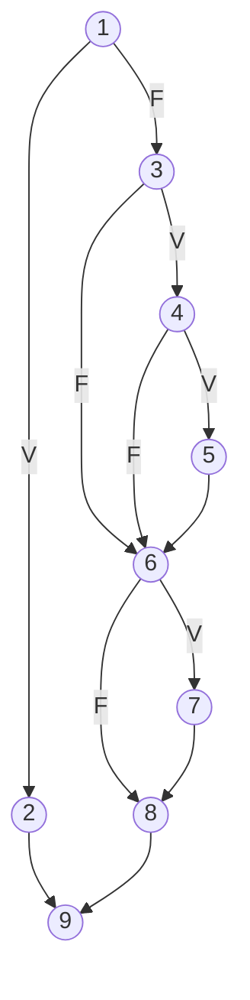

# Ejercicio 1 – Prueba de camino básico (caja blanca)

## Función bajo prueba

Implementación: [`DescuentoCliente.java`](../src/main/java/iso/tp2/ejercicio1/DescuentoCliente.java)

Reglas de negocio del descuento especial:

| Regla | Condición | Descuento |
| --- | --- | --- |
| Validación | `montoCompra <= 0` | se rechaza (`IllegalArgumentException`) |
| Condición de socio | `esSocio` | 10 % |
| Antigüedad (solo socios) | `antiguedadAnios >= 5` | +5 % |
| Monto de compra | `montoCompra >= 100.000` | +5 % (socio o no) |

La función devuelve el **importe final** a pagar: `montoCompra * (100 - porcentaje) / 100`.

```java
public static double procesarDescuentoCliente(int antiguedadAnios, double montoCompra, boolean esSocio) {
    if (montoCompra <= 0) {                                   // 1 (P1)
        throw new IllegalArgumentException("...");            // 2
    }
    int porcentaje = 0;                                       // 3
    if (esSocio) {                                            // 3 (P2)
        porcentaje = 10;                                      // 4
        if (antiguedadAnios >= ANTIGUEDAD_MINIMA_FIDELIDAD) { // 4 (P3)
            porcentaje += 5;                                  // 5
        }
    }
    if (montoCompra >= MONTO_COMPRA_MAYORISTA) {              // 6 (P4)
        porcentaje += 5;                                      // 7
    }
    return montoCompra * (100 - porcentaje) / 100;            // 8
}                                                             // 9 (fin)
```

Todas las decisiones son **condiciones simples** (sin `&&` ni `||`), por lo que cada `if` aporta
exactamente un nodo predicado.

## 1. Grafo de flujo de control


| Nodo | Sentencias | Tipo |
| --- | --- | --- |
| 1 | `if (montoCompra <= 0)` | predicado P1 |
| 2 | `throw new IllegalArgumentException(...)` | proceso |
| 3 | `porcentaje = 0; if (esSocio)` | predicado P2 |
| 4 | `porcentaje = 10; if (antiguedadAnios >= 5)` | predicado P3 |
| 5 | `porcentaje += 5` | proceso |
| 6 | `if (montoCompra >= 100.000)` (unión de 3-F, 4-F y 5) | predicado P4 |
| 7 | `porcentaje += 5` | proceso |
| 8 | `return montoCompra * (100 - porcentaje) / 100` (unión de 6-F y 7) | proceso |
| 9 | fin del método (unión de 2 y 8) | salida |

Aristas (A = 12):

| # | Arista | # | Arista | # | Arista |
| --- | --- | --- | --- | --- | --- |
| a1 | 1 → 2 (V) | a5 | 3 → 6 (F) | a9 | 6 → 7 (V) |
| a2 | 1 → 3 (F) | a6 | 4 → 5 (V) | a10 | 6 → 8 (F) |
| a3 | 2 → 9 | a7 | 4 → 6 (F) | a11 | 7 → 8 |
| a4 | 3 → 4 (V) | a8 | 5 → 6 | a12 | 8 → 9 |

Versión Mermaid del mismo grafo (se renderiza en GitHub / VS Code):



## 2. Complejidad ciclomática V(G)

| Método | Cálculo | Resultado |
| --- | --- | --- |
| Aristas y nodos | V(G) = A − N + 2 = 12 − 9 + 2 | **5** |
| Nodos predicado | V(G) = P + 1 = 4 + 1 (nodos 1, 3, 4 y 6) | **5** |
| Regiones | R1, R2, R3, R4 (cerradas) + R5 (exterior) | **5** |

Regiones del grafo plano:

| Región | Delimitada por |
| --- | --- |
| R1 | 1 → 2 → 9 ← 8 ← 7 ← 6 ← 5 ← 4 ← 3 ← 1 |
| R2 | 3 → 4 → 6 y 3 → 6 |
| R3 | 4 → 5 → 6 y 4 → 6 |
| R4 | 6 → 7 → 8 y 6 → 8 |
| R5 | región exterior |

Los tres métodos coinciden: **V(G) = 5**. Ese es el número de caminos independientes del conjunto
básico y, por lo tanto, la cantidad mínima de casos de prueba que garantiza ejecutar cada
sentencia y cada rama al menos una vez.

## 3. Conjunto básico de caminos independientes

| Camino | Secuencia de nodos | Aristas nuevas que aporta |
| --- | --- | --- |
| C1 | 1 → 2 → 9 | a1, a3 |
| C2 | 1 → 3 → 6 → 8 → 9 | a2, a5, a10, a12 |
| C3 | 1 → 3 → 4 → 6 → 8 → 9 | a4, a7 |
| C4 | 1 → 3 → 4 → 5 → 6 → 8 → 9 | a6, a8 |
| C5 | 1 → 3 → 6 → 7 → 8 → 9 | a9, a11 |

Cada camino incorpora al menos una arista que no recorrían los anteriores, por lo que son
linealmente independientes. Entre los cinco cubren las 12 aristas y los 9 nodos.

## 4. Casos de prueba por camino

| Caso | Camino | antigüedad | monto | socio | Resultado esperado | Porcentaje |
| --- | --- | --- | --- | --- | --- | --- |
| CP1 | C1 | 3 | 0 | true | `IllegalArgumentException` | – |
| CP2 | C2 | 2 | 50.000 | false | 50.000 | 0 % |
| CP3 | C3 | 2 | 50.000 | true | 45.000 | 10 % |
| CP4 | C4 | 8 | 50.000 | true | 42.500 | 15 % |
| CP5 | C5 | 1 | 200.000 | false | 190.000 | 5 % |

Además del conjunto básico, se agregaron casos **complementarios** de valores límite (no
necesarios para la cobertura de caminos, pero útiles para detectar errores de frontera):

| Caso | antigüedad | monto | socio | Esperado | Qué verifica |
| --- | --- | --- | --- | --- | --- |
| CX1 | 4 | 50.000 | true | 45.000 | antigüedad justo debajo de 5 |
| CX2 | 5 | 50.000 | true | 42.500 | antigüedad justo en 5 |
| CX3 | 0 | 99.999,99 | false | 99.999,99 | monto justo debajo de 100.000 |
| CX4 | 0 | 100.000 | false | 95.000 | monto justo en 100.000 |
| CX5 | 0 | 0,01 | false | 0,01 | menor monto válido |
| CX6 | 10 | 100.000 | true | 80.000 | descuento máximo (20 %) |
| CX7 | 10 | 99.999,99 | true | 84.999,9915 | socio fiel, monto debajo de 100.000 |
| CX8 | 5 | −0,01 | true | `IllegalArgumentException` | monto negativo |

Automatización: [`DescuentoClienteTest.java`](../src/test/java/iso/tp2/ejercicio1/DescuentoClienteTest.java)
(grupo *Caminos básicos* = CP1..CP5, grupo *Complementarios* = CX1..CX8).

### Verificación de la cobertura

JaCoCo (`target/site/jacoco/index.html`, se genera con `mvn test`) informa para
`DescuentoCliente`: **8 de 8 ramas** y **10 de 10 líneas** cubiertas. Las 8 ramas corresponden a
las salidas V/F de los 4 nodos predicado, lo que confirma que los 5 caminos básicos alcanzan
cobertura completa de decisiones.
